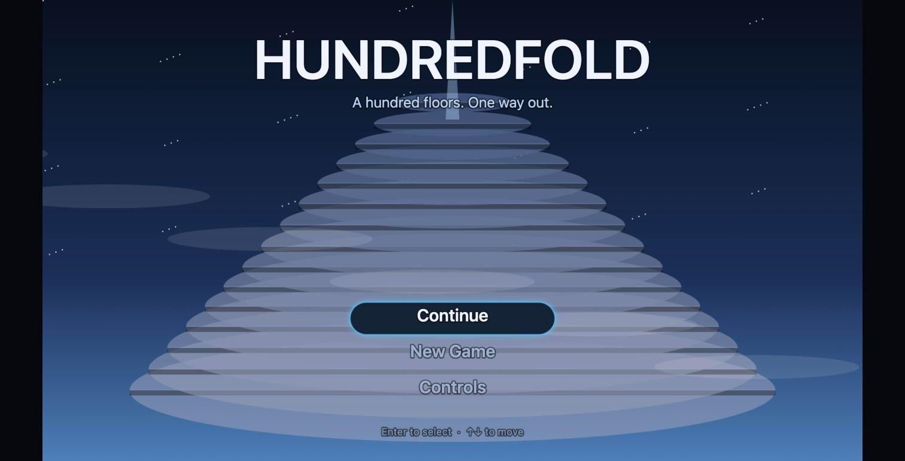
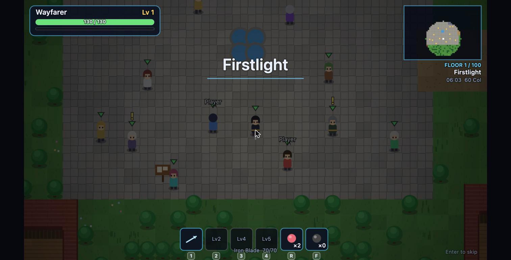
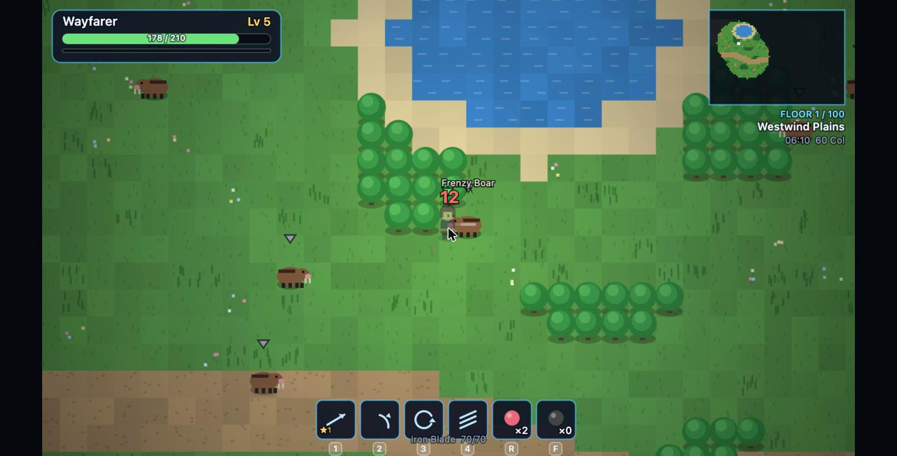
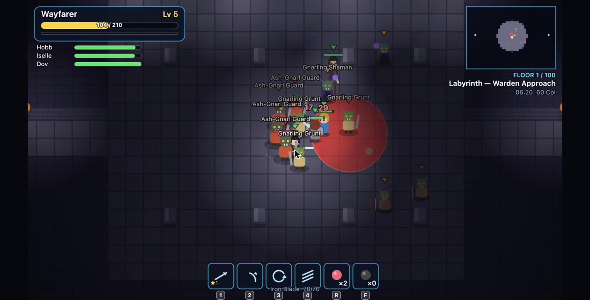
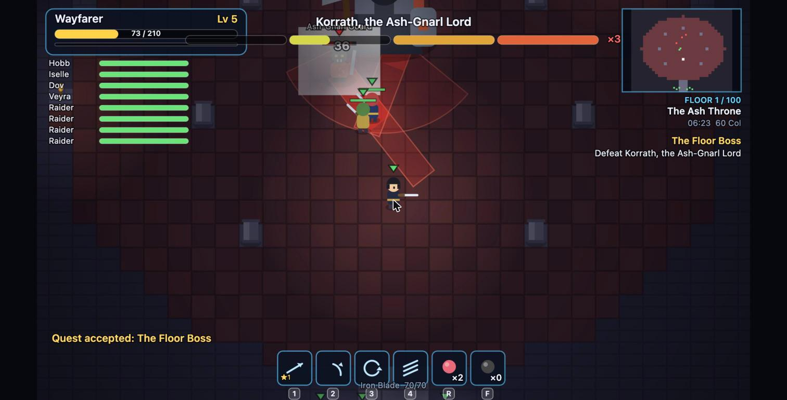

# Hundredfold

A top-down action RPG about being trapped in a 100-floor death-game VRMMO. This build covers Floor 1: a starting town, open fields, a forest, a village, a three-level labyrinth and a four-bar floor boss. Everything runs in the browser on a plain canvas; music and sound effects are synthesized in code.

| | |
|---|---|
|  |  |
| Firstlight, the starting town | Fighting boars on the plains |
|  |  |
| A raid party in the labyrinth | The floor boss, with its telegraphed attacks |

## Run it

    npm install
    npm run dev      # play at the printed localhost URL
    npm test         # content validation and logic tests
    npm run build

## Controls

| Key | Action |
|---|---|
| WASD / arrows | Move |
| J / Space | Attack (tap three times for a combo) |
| K | Block. Tap just before a hit lands to parry |
| L / Shift | Dodge roll |
| 1–4 | Sword skills (you are frozen briefly afterwards) |
| Q | Switch in on a staggered enemy |
| E | Talk, open, pull |
| R / F | Healing draught / mending crystal |
| Tab | Menu: items, gear, skills, stats, quests |
| M, Esc, F3 | Map, pause, debug overlay |

## Content

Names, dialogue, quests, maps and mob stats live in `src/data`, and `src/data/validate.ts` checks them at startup. See [CONTENT.md](CONTENT.md) for how to change them or swap in image sprites.

## Status

Floor 1 only. Balance is untuned and the game has had very little play-testing.
